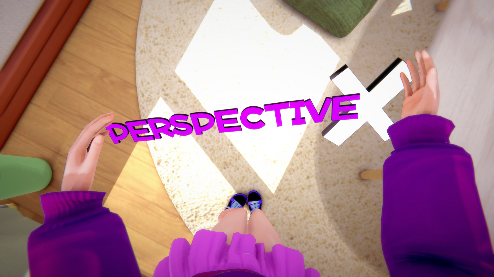

# KK_PerspectiveX

一个用于 Koikatsu 的第一人称 POV 插件，不会穿模到身体里，也不会让人头晕。

适用于本篇游戏（自由漫游）、H 场景和 CharaStudio。



同一个 DLL 同时支持 Koikatsu 和 Koikatsu Sunshine。我在两者上都玩了很久，表现一致；不过 Sunshine 更新，且作为 POV mod 的目标较少见，所以偶尔可能会有 Sunshine 特有的 bug 漏过。如果两个游戏将来差异大到需要拆分，我会拆分插件，但目前一个 DLL 覆盖两者完全没问题。

有一个繁体中文（ZH-TW）翻译分支，由 Tokozakura 维护：[releases](https://github.com/Tokozakura/KK_PerspectiveX_ZH-TW/releases)。

## 为什么还要再做一个 POV mod？

因为现有的那些一直让我很烦。有些把相机放在错误的位置，导致视角在胸部高度，头部穿进屏幕。RealPOV 位置放对了，但会复制头部骨骼的完整动画旋转（包括 roll），所以视角会侧倾，并且随每个动画晃动。PerspectiveX 将位置和旋转分开处理：

| | PerspectiveX | RealPOV | KK_StudioPOV（仅 Studio） |
|---|---|---|---|
| **视角** | 真正的眼睛高度，位于实际眼骨的中点 | 相同的眼骨中点 | 相同的眼骨中点 |
| **旋转** | 完全由鼠标控制，独立于角色骨骼，地平线始终保持水平。可选的“动画摇摆”允许可配置量的头部运动通过，但始终移除 roll | 覆盖颈部骨骼，但相机仍继承头部的完整世界旋转，因此动画中的脊柱/胸部倾斜仍会使视角侧滚 | 每帧复制眼骨的原始旋转，因此任何动画或姿势编辑都会直接旋转相机，俯仰角没有限制 |
| **在 POV 中摆姿势** | 移动骨骼（例如使用 KKPE）不会旋转你的视角——旋转完全由你控制 | 链上更高层的骨骼编辑仍可能倾斜相机，因为旋转没有完全解耦 | 骨骼编辑会立即移动相机，因为它实时读取骨骼旋转 |
| **隐藏头部** | 仅隐藏头部的渲染器：它从视野中消失，但仍正常播放动画，并且不会写入角色或场景文件 | 翻转角色存储的“头部始终可见”标志（可选，默认关闭） | 停用整个头部对象；由于 Unity 会停止对已停用骨骼的动画，眼睛位置可能冻结而身体继续移动，导致相机漂移并穿入身体 |
| **鼠标视角限制** | 干净的偏航/俯仰，无环绕问题 | 未限制的旋转累积 | 未限制的旋转累积——拖动足够多会让视角上下颠倒 |
| **舒适选项** | 位置平滑、动画摇摆混合、前/上偏移、实时 FOV、一键预设、可保存视角槽位、相机锁定——均可在 POV 中调整 | FOV、灵敏度、固定偏移 | FOV、灵敏度 |

（基于阅读 [RealPOV](https://github.com/Keelhauled/KeelPlugins) 和 [KK_StudioPOV](https://github.com/Mantas-2155X/StudioPOV) 的公开源码——描述代码行为，并非贬低这两个项目。）

## 安装

1. 你需要 BepInEx 5（HF Patch 已包含）。
2. 从 [Releases](../../releases) 下载 `KK_PerspectiveX.dll`，放入 `BepInEx/plugins/`。
3. 如果你安装了 RealPOV（我记得 HF Patch 包含它），请将 `RealPOV.Koikatu.dll` 重命名为 `RealPOV.Koikatu.dll.disabled` 来禁用它，因为两个插件都用 Backspace 作为切换键。

已在 KK 和 KKS 上使用 BepInEx 5+ 测试和游玩。如果在你的环境中无法使用，请[打开 issue](../../issues)，我会看看。

## 控制

所有按键均可通过 ConfigurationManager（F1）重新绑定。

- **Backspace**：切换 POV。在 Studio 中，请先在工作区选择一个角色。
- **鼠标左键（按住 + 拖动）**：环顾四周。其他时候光标保持可见且可用。
- **Ctrl+L**：免手持 FPS 鼠标视角。光标会被捕获，直到你再次按下。
- **Ctrl+Shift+Left / Ctrl+Shift+Right**：将 POV 切换到上一个/下一个角色。
- **滚轮**：在 POV 中调整 FOV（如果你经常误触，可以在设置中关闭）。
- **Comma / Period**：向左/右倾斜相机。**Slash** 将倾斜重置为水平。
- **Semicolon**：将相机锁定在原位。视角停止跟随头部，这在会甩动头部的爱抚动画中很方便；环顾仍然有效。再次按下解锁，相机会滑回。
- **Ctrl+Shift+1/2/3**：将当前视角（FOV、视线方向、倾斜、相机偏移）保存到槽位。**Ctrl+1/2/3**：调出。槽位在游戏会话之间会保留。
- **Ctrl+P**：打开预设面板。在 Studio 中，你也可以点击左下角工具栏中的 PerspectiveX 眼睛按钮。

### 预设面板

游戏内面板将所有与预设相关的内容集中在一处，无需翻配置文件：

- **视角预设**：一键设置（Cozy 60 / Natural 90 / Action 110），同时设置 FOV、位置平滑和相机偏移。
- **自定义预设**：调出你喜欢的 FOV/平滑/偏移组合，输入名称，并将其保存为你自己的一键预设（最多 5 个）。
- **已保存视角**：与快捷键相同的三个保存/调出槽位，以按钮形式呈现，并显示每个槽位的 FOV。

舒适设置（位置平滑、动画摇摆、FOV、偏移）位于插件设置中，可在 POV 中实时调整。视角预设也可在那里使用。可选的“将相机与身体对齐”设置会倾斜视角以匹配角色的身体朝向，例如当他们侧躺时，而不是保持地平线水平。

## 从源码构建

该插件面向 .NET Framework 3.5，可在任何操作系统上使用常规 .NET SDK 构建。
首先将以下引用 DLL 从你的游戏安装目录复制到 `lib/`（它们受版权保护，因此未包含在此处）：

- `BepInEx/core/`：`BepInEx.dll`、`0Harmony.dll`
- `Koikatu_Data/Managed/`：`Assembly-CSharp.dll`、`Assembly-CSharp-firstpass.dll`、`UnityEngine.dll`、`UnityEngine.UI.dll`

然后：

```sh
cd src/KK_PerspectiveX
dotnet build -c Release
```

输出：`src/KK_PerspectiveX/bin/Release/KK_PerspectiveX.dll`

## XMods

- [KK_PerspectiveX](https://github.com/bani4kaskashka/KK_PerspectiveX)：不会穿模到身体里、也不会让人头晕的第一人称 POV（就是这个）
- [StudioHeightX](https://github.com/bani4kaskashka/KK-KKS-StudioHeightX)：所选 Studio 角色的实时身高读数
- [PerceptiveHeightX](https://github.com/bani4kaskashka/PerceptiveHeightX)：PerspectiveX 的 POV 尺寸感知附加组件

## 致谢

更好的 VR 支持由 [HanYuanyi](https://github.com/HanYuanyi) 提供。

## 我的链接

- [Patreon](https://www.patreon.com/c/zamalkogts)
- [DeviantArt](https://www.deviantart.com/zamalkogts)

## 许可证

[MIT](LICENSE)

----------------------------------------------------------------------------------------------------------------------------------------------------------

# KK_PerspectiveX

A first-person POV plugin for Koikatsu that doesn't clip through the body and doesn't make you dizzy.

Works in the main game (free roam), H scenes, and CharaStudio.


Supports both Koikatsu and Koikatsu Sunshine with the same DLL. I've played it plenty on both and they behave the same, though Sunshine is the newer and less common target for POV mods, so the occasional Sunshine-specific bug can slip through. If the two games ever diverge enough I'll split the plugin, but for now one DLL covers both just fine.

A Traditional Chinese (ZH-TW) translation fork is available, maintained by Tokozakura: [releases](https://github.com/Tokozakura/KK_PerspectiveX_ZH-TW/releases).

## Why another POV mod?

Because the existing ones kept annoying me. Some place the camera at the wrong spot, so you get a chest-level view with the head clipping into the screen. RealPOV places it correctly but copies the head bone's full animation rotation, roll included, so the view tilts sideways and jerks around with every animation. PerspectiveX handles position and rotation separately:

| | PerspectiveX | RealPOV | KK_StudioPOV (Studio-only) |
|---|---|---|---|
| **Viewpoint** | True eye level, at the midpoint of the actual eye bones | Same eye-bone midpoint | Same eye-bone midpoint |
| **Rotation** | Fully mouse-controlled and independent of the character's bones, horizon always level. Optional "animation sway" lets a configurable amount of head motion through, with roll always removed | Overrides the neck bone, but the camera still inherits the head's full world rotation, so animated spine/chest lean still rolls the view | Copies the eye bone's raw rotation every frame, so any animation or pose edit rotates the camera directly, with no limit on pitch |
| **Posing while in POV** | Moving bones (e.g. with KKPE) doesn't spin your view - rotation is entirely yours | Bone edits up the chain can still tilt the camera, since rotation isn't fully decoupled | Bone edits move the camera immediately, since it reads the bone's rotation live |
| **Head hiding** | Hides the head's renderers only: it vanishes from view but keeps animating normally, and nothing is written into your character or scene files | Flips the character's stored "head always visible" flag (optional, off by default) | Deactivates the whole head object; since Unity stops animating deactivated bones, the eye position can freeze while the body keeps moving, letting the camera drift and clip into the body |
| **Mouse look limits** | Clean yaw/pitch, no wraparound | Unclamped rotation accumulation | Unclamped rotation accumulation - enough drag can flip the view upside down |
| **Comfort options** | Position smoothing, animation-sway blend, forward/up offsets, live FOV, one-click presets, saveable view slots, camera lock - all adjustable mid-POV | FOV, sensitivity, fixed offset | FOV, sensitivity |

(Based on reading the public source of [RealPOV](https://github.com/Keelhauled/KeelPlugins) and [KK_StudioPOV](https://github.com/Mantas-2155X/StudioPOV) - describing what the code does, not a knock on either project.)

## Installation

1. You need BepInEx 5 (already included in HF Patch).
2. Download `KK_PerspectiveX.dll` from [Releases](../../releases) and drop it into `BepInEx/plugins/`.
3. If you have RealPOV installed (I think HF Patch includes it), disable it by renaming `RealPOV.Koikatu.dll` to `RealPOV.Koikatu.dll.disabled`, since both plugins use Backspace as the toggle key.

Tested and played on KK and KKS with BepInEx 5+. If it doesn't work on your setup, please [open an issue](../../issues) and I'll take a look.

## Controls

Everything is rebindable via ConfigurationManager (F1).

- **Backspace**: toggle POV. In Studio, select a character in the workspace first.
- **Left mouse (hold + drag)**: look around. The cursor stays visible and usable otherwise.
- **Ctrl+L**: hands-free FPS mouse look. The cursor is captured until you press it again.
- **Ctrl+Shift+Left / Ctrl+Shift+Right**: switch the POV to the previous/next character.
- **Scroll wheel**: adjust FOV while in POV (can be turned off in the settings if you keep hitting it by accident).
- **Comma / Period**: tilt the camera left/right. **Slash** resets the tilt to level.
- **Semicolon**: lock the camera in place. The view stops following the head, which is handy during caress animations that toss it around; looking around still works. Press again to unlock and the camera glides back.
- **Ctrl+Shift+1/2/3**: save the current view (FOV, look direction, tilt, camera offsets) into a slot. **Ctrl+1/2/3**: recall it. Slots are remembered between game sessions.
- **Ctrl+P**: open the presets panel. In Studio you can also click the PerspectiveX eye button in the bottom-left toolbar.

### Presets panel

The in-game panel collects everything preset-related in one place, no config diving needed:

- **View presets**: one-click setups (Cozy 60 / Natural 90 / Action 110) that set FOV, position smoothing and camera offset together.
- **Custom presets**: dial in your favorite FOV/smoothing/offset combo, type a name, and save it as your own one-click preset (up to 5).
- **Saved views**: the same three save/recall slots as the hotkeys, as buttons, with each slot's FOV shown.

Comfort settings (position smoothing, animation sway, FOV, offsets) are in the plugin settings, adjustable live while in POV. The view presets are available there too. An optional "Align camera with body" setting tilts the view to match the character's body orientation, for example when they're lying on their side, instead of keeping the horizon level.

## Building from source

The plugin targets .NET Framework 3.5 and builds with the regular .NET SDK on any OS.
Copy these reference DLLs from your game install into `lib/` first (they are copyrighted, so not included here):

- `BepInEx/core/`: `BepInEx.dll`, `0Harmony.dll`
- `Koikatu_Data/Managed/`: `Assembly-CSharp.dll`, `Assembly-CSharp-firstpass.dll`, `UnityEngine.dll`, `UnityEngine.UI.dll`

Then:

```sh
cd src/KK_PerspectiveX
dotnet build -c Release
```

Output: `src/KK_PerspectiveX/bin/Release/KK_PerspectiveX.dll`

## The XMods

- [KK_PerspectiveX](https://github.com/bani4kaskashka/KK_PerspectiveX): first-person POV that doesn't clip through the body and doesn't make you dizzy (this one)
- [StudioHeightX](https://github.com/bani4kaskashka/KK-KKS-StudioHeightX): live height readout for the selected Studio character
- [PerceptiveHeightX](https://github.com/bani4kaskashka/PerceptiveHeightX): POV size-perception add-on for PerspectiveX

## Credits

Better VR support provided by [HanYuanyi](https://github.com/HanYuanyi).

## My links

- [Patreon](https://www.patreon.com/c/zamalkogts)
- [DeviantArt](https://www.deviantart.com/zamalkogts)

## License

[MIT](LICENSE)
